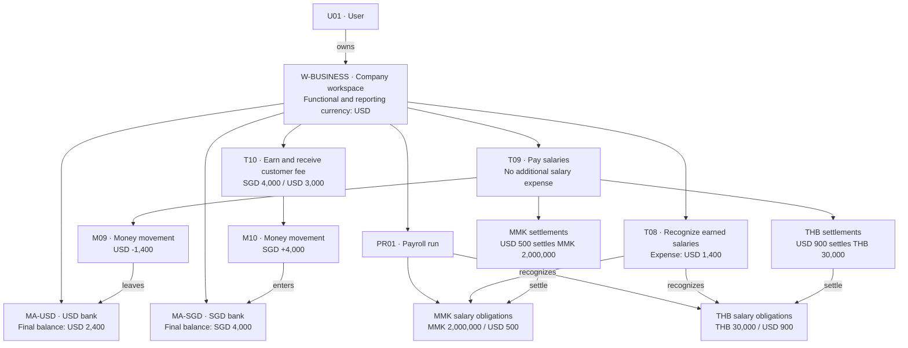
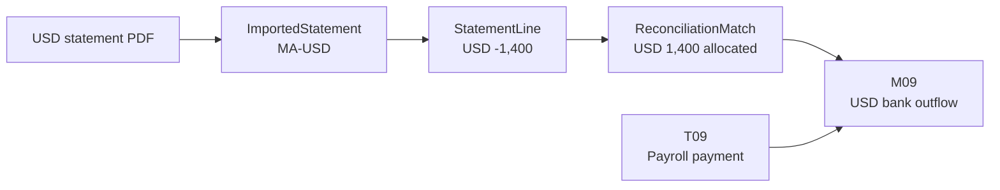

# Proposed model mapped to the accounting example

**Status:** This document describes the earlier expanded proposal. The current simplified schema is [DATA_MODEL.md](DATA_MODEL.md), which supersedes its entity/table choices. Documents/imports/matching, revaluation, payroll recording, and budgets are deferred. Financial amounts below remain reference examples; their inclusion does not mean those modules are implemented in the current version.

This document maps the proposed Microfin entities to [ACCOUNTING_EXAMPLE.md](ACCOUNTING_EXAMPLE.md). The reference example supplies all financial events, amounts, exchange rates, and expected accounting results. This mapping does not change those assumptions.

Identifiers introduced here are illustrative. Dates, employees, clients, suppliers, and documents are not identified in the reference; they are not invented as factual records here. Budget and uploaded-document examples are explicitly hypothetical extensions.

## 1. Workspace and currency boundary

| Entity | Example record | Meaning |
|---|---|---|
| User | `U01` | The user who owns the company workspace |
| Workspace | `W-BUSINESS` | The software outsourcing company; type `business` |
| Workspace functional currency | `USD` | Required by this exercise; overrides the earlier proposed THB default for this example only |
| Workspace reporting currency | `USD` | All accounting totals below use USD |
| Currency | `USD`, `SGD`, `THB`, `MMK` | Shared currency definitions; financial records reference them |
| MoneyAccount | `MA-USD` | USD bank; opening balance USD 0 |
| MoneyAccount | `MA-SGD` | SGD bank; opening balance SGD 0 |

Every company-owned entity carries `workspace_id = W-BUSINESS`, or inherits that boundary through a required parent. Links must resolve within the same workspace. Shared currency definitions are an exception to workspace ownership.

There are **two money accounts**, not four. MMK and THB appear in salary obligations and settlements; the company never holds those currencies in a bank account in this exercise. A separate personal workspace would have its own accounts and records and is outside this example.

Store original amounts and USD book amounts separately. For example:

```text
original_amount:     2,000,000
original_currency:   MMK
functional_amount:  500.00
functional_currency: USD
rate_to_functional:  0.00025 USD per MMK
```

The rate used is a preserved conversion snapshot, not a mutable lookup that silently changes earlier postings. This exercise uses the supplied fixed rates throughout; changing rates, fees, and foreign-exchange gains or losses are outside its scenarios.

## 2. Concrete relationship diagram



The payroll obligation and settlement boxes represent **group totals** from the reference, not invented employee-level rows. In the actual application, a payroll run contains employee-level obligations linked to employee parties; employee-level settlements sum to the amounts shown here. The source does not supply enough information to enumerate those rows.

## 3. Money accounts, ledger accounts, and categories

`MoneyAccount` is what the user sees as a bank, cash, wallet, or card account. `LedgerAccount` also represents noncash assets, liabilities, equity, revenue, and expenses.

Each money account maps to one ledger account. Many ledger accounts have no money account.

| Source ledger account | Model mapping | User-facing purpose |
|---|---|---|
| `A-USD` | LedgerAccount linked to `MA-USD` | USD bank |
| `A-SGD` | LedgerAccount linked to `MA-SGD` | SGD bank |
| `A-DEPOSIT` | Asset LedgerAccount; no MoneyAccount | Refundable office deposit |
| `A-COMPUTERS` | Asset LedgerAccount; no MoneyAccount | Computers owned by the company |
| `A-DESKS` | Asset LedgerAccount; no MoneyAccount | Furniture owned by the company |
| `L-PAY-MMK` | Liability LedgerAccount; no MoneyAccount | MMK salaries owed |
| `L-PAY-THB` | Liability LedgerAccount; no MoneyAccount | THB salaries owed |
| `E-CAPITAL` | Equity LedgerAccount; no MoneyAccount | Owner contribution |
| `R-SERVICES` | Revenue LedgerAccount; category `Software services` | Earned customer fees |
| `X-RENT` | Expense LedgerAccount; category `Office rent` | Consumed office use |
| `X-VISA` | Expense LedgerAccount; category `Visa processing` | Completed visa services |
| `X-TRAVEL` | Expense LedgerAccount; category `Developer travel` | Completed travel |
| `X-PAY-MMK` | Expense LedgerAccount; category `Salaries — MMK team` | MMK team service cost |
| `X-PAY-THB` | Expense LedgerAccount; category `Salaries — THB team` | THB team service cost |

For this example, each category maps to the corresponding revenue or expense ledger account. Category is an approachable label for entry and budgets; ledger account determines accounting treatment. The MVP should prevent category mappings from being changed in a way that silently rewrites historical postings.

Buying computers, paying a refundable deposit, and contributing capital all move money, but do not become operating expenses merely because they appear in Activity.

## 4. All ten events mapped to model records

`Transaction` is a financial event, including noncash events. `TransactionLine` describes its business components. `MoneyMovement` exists only when a tracked money account changes. Each posted event in this example produces one `JournalEntry`; its `JournalLine` rows implement the debit/credit posting.

Amounts in the last column are USD book values. The original journal account identifiers are retained.

| Event | Transaction and business lines | MoneyMovement | Obligation / settlement | JournalEntry posting |
|---|---|---|---|---|
| `T01` Owner contribution | `owner_contribution`; one line for USD 10,000 | `M01`: `MA-USD` +10,000 USD | None; this is equity, not a loan | Dr `A-USD` 10,000; Cr `E-CAPITAL` 10,000 |
| `T02` Refundable deposit | `deposit_payment`; one line for USD 1,000, targeting deposit asset | `M02`: `MA-USD` -1,000 USD | None required for this immediate asset payment | Dr `A-DEPOSIT` 1,000; Cr `A-USD` 1,000 |
| `T03` Current-month rent | `expense_payment`; one line for USD 1,000, category Office rent | `M03`: `MA-USD` -1,000 USD | None required for this immediate expense | Dr `X-RENT` 1,000; Cr `A-USD` 1,000 |
| `T04` Computers | `asset_purchase`; one line for USD 3,000, targeting computers asset | `M04`: `MA-USD` -3,000 USD | None; paid immediately | Dr `A-COMPUTERS` 3,000; Cr `A-USD` 3,000 |
| `T05` Desks | `asset_purchase`; one line for USD 500, targeting desks asset | `M05`: `MA-USD` -500 USD | None; paid immediately | Dr `A-DESKS` 500; Cr `A-USD` 500 |
| `T06` Visa services | `expense_payment`; one line for USD 500, category Visa processing | `M06`: `MA-USD` -500 USD | None required for this immediate expense | Dr `X-VISA` 500; Cr `A-USD` 500 |
| `T07` Developer travel | `expense_payment`; one line for USD 200, category Developer travel | `M07`: `MA-USD` -200 USD | None required for this immediate expense | Dr `X-TRAVEL` 200; Cr `A-USD` 200 |
| `T08` Earned payroll | `payroll_accrual`; MMK and THB salary lines grouped under `PR01` | None | Creates salary obligations totaling MMK 2,000,000 and THB 30,000 | Dr `X-PAY-MMK` 500; Dr `X-PAY-THB` 900; Cr `L-PAY-MMK` 500; Cr `L-PAY-THB` 900 |
| `T09` Payroll settlement | `payroll_payment`; two settlement components in this grouped presentation | `M09`: `MA-USD` -1,400 USD | Settles all T08 salary obligations | Dr `L-PAY-MMK` 500; Dr `L-PAY-THB` 900; Cr `A-USD` 1,400 |
| `T10` Earned customer fee | `income_receipt`; one line for SGD 4,000, category Software services | `M10`: `MA-SGD` +4,000 SGD | None; earned and paid immediately | Dr `A-SGD` 3,000; Cr `R-SERVICES` 3,000 |

For the grouped presentation, there are **10 transactions, 9 money movements, 10 journal entries, and 23 journal lines**. Employee-level payroll detail can increase business-line and settlement counts without changing the accounting totals.

`TransactionLine` and `JournalLine` have different jobs. A single business line can generate several journal lines. For example, the rent line becomes an expense debit and bank credit. T09's business lines describe which obligations are being settled; they must not generate a second salary expense.

## 5. Payroll: recognition and payment are separate events

### T08: work has been performed

| Payroll-run summary | Original amount owed | USD book value | Outstanding after T08 |
|---|---:|---:|---:|
| MMK team | MMK 2,000,000 | 500 | MMK 2,000,000 |
| THB team | THB 30,000 | 900 | THB 30,000 |

Each actual salary obligation needs a link to `PR01`, its employee Party, its recognizing transaction `T08`, its currency and amount, and the relevant payable ledger account. Employee names and individual amounts must come from payroll input; the reference only supplies group totals.

After T08, salary expense is USD 1,400 and salary liabilities are USD 1,400. Bank balances have not changed because T08 creates no MoneyMovement.

### T09: the USD bank converts and remits salaries

A settlement must retain both the amount discharged in the obligation's currency and the portion of the payment used to discharge it. A single ambiguous `amount` field would not describe this example adequately.

| Settlement summary | Payment transaction | Payment funding portion | Obligation amount discharged | USD carrying amount discharged | Remaining obligation |
|---|---|---:|---:|---:|---:|
| MMK employee settlements | `T09` | USD 500 | MMK 2,000,000 | USD 500 | MMK 0 |
| THB employee settlements | `T09` | USD 900 | THB 30,000 | USD 900 | THB 0 |

The payment funding portions total USD 1,400 and link back to the same USD bank outflow. There is no company-held MMK or THB money movement. After T09, salary liabilities are zero, USD cash is reduced by 1,400, and salary expense remains 1,400.

The user flow can therefore be:

```text
Record payroll → Review salaries owed → Pay from USD bank → Confirm recipient amounts
```

The application creates the accrual and settlement postings underneath that flow.

## 6. Parties and unpaid invoices or bills

The reference implies an owner, customer, office lessor, equipment suppliers, visa-service supplier, travel supplier, and employees, but does not name them. Party records can be populated when those details are supplied. The model does not require a registered app user for each employee or supplier.

T10 is immediate earned income. Do not invent a receivable or an extra invoice-recognition transaction for it. Likewise, the immediate payments T02–T07 do not require intermediate unpaid-bill records.

For a future unpaid customer invoice, the same model supports:

```text
Recognize earned invoice → Transaction + customer Obligation + journal entry
Receive payment         → Transaction + MoneyMovement + Settlement + journal entry
```

That is a supported path, not an additional event in the reference example. Recognition rules for unearned customer invoices or advances need their own examples; the diagram alone does not define those rules.

## 7. Documents and statement reconciliation

The reference supplies no actual uploaded files or statement rows. The following attachments and imports illustrate how evidence could connect to the existing records; they do not add financial events.

| Hypothetical uploaded document | Links / derived records | Result |
|---|---|---|
| Current-month rent receipt | Document linked to `T03` | Evidence for the existing USD 1,000 expense |
| Computer purchase receipt | Document linked to `T04` | Evidence for the existing asset purchase |
| Payroll schedule | Document linked to `PR01`, `T08`, and its employee obligations | Supports salary recognition |
| Payroll remittance confirmation | Document linked to `T09` | Supports the USD 1,400 payment and salary settlements |
| USD bank statement | Document → ImportedStatement for `MA-USD` → StatementLine records | Lines match `M01` through `M07`, plus `M09` |
| SGD bank statement | Document → ImportedStatement for `MA-SGD` → StatementLine records | SGD 4,000 credit matches `M10` |

For this illustration, assume one statement line for each money movement: eight USD lines and one SGD line. Real statements may split or combine payments, so `ReconciliationMatch` should retain an allocated amount and support multiple matching portions, with no portion counted twice.



Matching a line to `M09` does not create another payment, another expense, or a second journal entry. Imported lines remain reviewable evidence; creating a missing transaction is a separate confirmed action.

Payroll-schedule attachments also reveal a useful extension to the initial diagram: document links should support payroll runs, not just transactions and obligations.

## 8. Budget mapping: hypothetical extension

No budget is provided in the reference. To illustrate the entity relationships, suppose the user creates `B01`, a USD expense budget for the same unspecified exercise period, with these items:

| BudgetItem / Category | Hypothetical planned USD | Actual USD from posted expense lines | Remaining USD |
|---|---:|---:|---:|
| Office rent | 1,000 | 1,000 | 0 |
| Visa processing | 500 | 500 | 0 |
| Developer travel | 300 | 200 | 100 |
| Salaries — MMK team | 600 | 500 | 100 |
| Salaries — THB team | 900 | 900 | 0 |
| **Total** | **3,300** | **3,100** | **200** |

For this example, budget actuals follow recognized expenses: payroll counts at T08, not again at T09. Creating a budget produces no MoneyMovement, Obligation, or JournalEntry. Capital, the refundable deposit, and equipment purchases do not consume this operating-expense budget. A separate cash-spending budget would be a different planning view and should be named accordingly.

## 9. Reports derived from the posted ledger

Reports are calculated views rather than independent financial records to maintain by hand.

| View | Records used | Expected result after T10 |
|---|---|---|
| Account balances | Bank ledger postings, checked against MoneyMovements in each account currency | USD 2,400; SGD 4,000 |
| Total cash book value | USD carrying balances of `A-USD` and `A-SGD` | USD 5,400 |
| Profit and loss | Revenue and expense JournalLines | Revenue 3,000; expenses 3,100; loss 100 USD |
| Balance sheet | Asset, liability, and equity balances, including current-period result | Assets 9,900; liabilities 0; equity 9,900 USD |
| Unpaid payroll | Obligations less their settlements | MMK 0 and THB 0 |
| Expense budget | BudgetItems against category-linked recognized expenses | Actual 3,100 against hypothetical budget 3,300 USD |
| Reconciliation | Imported statement balances, lines, and matching allocations | Hypothetical statement closes: USD 2,400 and SGD 4,000 |

The pre-closing balance sheet includes capital of USD 10,000 and the current-period loss of USD 100. The loss is included once; an additional synthetic closing transaction is not part of this snapshot.

## 10. Design checks established by this example

- T08 is a valid Transaction with no MoneyMovement; a transaction must not require a bank account.
- Noncash asset accounts, payroll payable accounts, and expense accounts must not be mistaken for MoneyAccounts.
- Original currency amounts and USD book amounts remain distinguishable throughout entry, settlement, and reporting.
- T09 requires one USD MoneyMovement, employee settlements in two other currencies, and no extra salary expense.
- Payroll group totals are insufficient to invent employee-level payments; the entry flow must collect that detail when needed.
- The source's 10 transactions produce USD 22,000 of debits and USD 22,000 of credits. Its ending trial balance totals USD 13,000 on each side.
- Final cash is USD 2,400 plus SGD 4,000; their USD book value is 5,400.
- Assets total USD 9,900, liabilities zero, and equity USD 9,900 before depreciation and closing.
- Uploaded evidence and reconciliation matches do not duplicate an already-recorded financial event.
- The hypothetical budget changes planning information only; its payroll actuals are counted once at recognition.

These checks map the reference scenario to the proposed model. Partial payments, changing exchange rates, refunds, depreciation, unpaid supplier bills, and unpaid customer invoices need additional worked scenarios before the model is considered complete.
