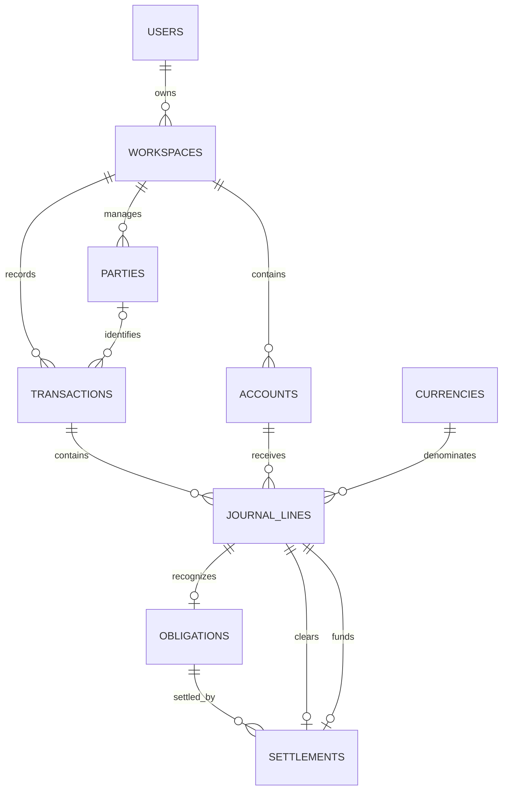

# Microfin: simple core data model

Status: implemented core schema in `supabase/migrations/`. This version supersedes the expanded proposal. PostgreSQL is provided by Supabase; deployments apply versioned migrations separately.

Current scope: registration, personal/business workspaces, multi-currency accounts, manual income/expenses/transfers, unpaid invoices/bills with partial payments, profit and loss, and balance sheet from posted records.

Deferred: documents, imports, matching/reconciliation, revaluation, payroll recording, and budgets. These have no tables, foreign keys, or transaction kinds in this version. Payroll entries in [ACCOUNTING_EXAMPLE.md](ACCOUNTING_EXAMPLE.md) remain educational examples, not a current payroll feature commitment.

## 1. Core structure: nine ledger tables and scenario storage

| Table | Purpose |
|---|---|
| `users` | Registered user |
| `currencies` | Currency codes and decimal precision |
| `workspaces` | Separate personal/business finances |
| `accounts` | Bank accounts, assets, liabilities, equity, income and expense categories |
| `parties` | Customers, suppliers, and other counterparties |
| `transactions` | Business event and journal header combined |
| `journal_lines` | Actual debit/credit amounts, currencies, and conversion rates |
| `obligations` | Metadata for an unpaid invoice or bill |
| `settlements` | Links between an obligation and its payment postings |
| `financial_scenarios` | Isolated, immutable experiments with an opening configuration and frozen source snapshot |

Changes that remove duplication:

- Merge `ledger_accounts`, `money_accounts`, and `categories` into `accounts`.
- Merge `journal_entries` into `transactions`: one event has one set of journal lines.
- Remove `transaction_lines`: financial amounts and account references live only on journal lines.
- Put the rate used on each journal line; remove the separate rate-snapshot entity.
- Derive obligation amounts, currencies, accounts, and counterparties from recognition postings.
- Derive settlement amounts from linked clearing/funding postings.
- Derive balances, totals, payment status, and account activity. Do not store editable copies.

The UI can still use simple actions such as Spend money or Buy equipment. The application generates balanced lines; users do not need to enter debits and credits themselves.

## 2. Conventions

- PK = primary key; FK = foreign key; `?` = nullable. IDs are UUIDs; names such as T10 below are readable aliases.
- Monetary amounts use `numeric(28,8)`; exchange rates use `numeric(38,18)`. Use decimal arithmetic and currency-specific rounding.
- Currency columns reference `currencies.code`. Dates use the workspace timezone; timestamps use `timestamptz`.
- Workspace-owned tables have `UNIQUE(workspace_id, id)`. References between them use composite FKs `(workspace_id, related_id)` to enforce a shared workspace. Index FK columns.
- Retaining `workspace_id` on financial children enforces tenant boundaries. It is not an independently editable ownership setting.
- Authenticate every operation and verify the workspace owner. This version has one owner per workspace, with no shared-membership tables.

## 3. Identity and workspace tables

### `users`

| Field | Type | Constraint / meaning |
|---|---|---|
| `id` | uuid | PK, FK to `auth.users.id` |
| `display_name` | text | Required |
| `created_at` | timestamptz | Required |

Supabase Auth manages registration, email, credentials, and sessions. The public profile stores only display metadata; it does not duplicate the authentication subject or email. Auth provider tables are outside these application entities.

### `currencies`

| Field | Type | Constraint / meaning |
|---|---|---|
| `code` | varchar(3) | PK, e.g. USD, THB, MMK, SGD |
| `minor_units` | smallint | Required, between 0 and 8 |

Static reference data. Currency names and symbols can come from localized display metadata.

### `workspaces`

| Field | Type | Constraint / meaning |
|---|---|---|
| `id` | uuid | PK |
| `owner_user_id` | uuid | FK users |
| `name` | text | Required |
| `kind` | text | personal or business |
| `functional_currency_code` | varchar(3) | FK currencies; currency of all book amounts |
| `timezone` | text | Required, e.g. Asia/Bangkok |
| `created_at` | timestamptz | Required |

Report currency equals functional currency in this version. Lock functional currency after the first posted transaction. Additional presentation currencies and functional-currency changes need a separate design.

## 4. Accounts and parties

### `accounts`

| Field | Type | Constraint / meaning |
|---|---|---|
| `id` | uuid | PK |
| `workspace_id` | uuid | FK workspaces |
| `name` | text | User-facing name |
| `type` | text | asset, liability, equity, revenue, expense |
| `role` | text | general, bank, cash, wallet, credit_card, receivable, payable |
| `currency_code` | varchar(3)? | Fixed native currency; required for every role except general |
| `is_active` | boolean | Default true; deactivate used accounts instead of deleting them |

| Role | Required type | Purpose |
|---|---|---|
| bank, cash, wallet | asset | Available-money account |
| credit_card | liability | Card amount owed |
| receivable | asset | Unpaid customer amounts, per currency |
| payable | liability | Unpaid supplier amounts, per currency |
| general | Any account type | Equipment, deposit, capital, income, or expense |

Role selects operational behavior; type determines accounting classification. General revenue/expense accounts appear as income/expense categories. There is no separate category mapping.

Examples from the accounting reference:

| Alias | Name | Type | Role | Currency restriction |
|---|---|---|---|---|
| A-USD | USD bank | asset | bank | USD |
| A-SGD | SGD bank | asset | bank | SGD |
| A-DEPOSIT | Refundable office deposit | asset | general | USD |
| A-COMPUTERS | Computers | asset | general | None |
| E-CAPITAL | Owner's capital | equity | general | None |
| R-SERVICES | Software services | revenue | general | None |
| X-RENT | Office rent | expense | general | None |

After posting, an account's type, role, and currency restriction cannot be changed in place. Renaming changes display only. Balances are derived. Opening balances use an opening-balance transaction against the appropriate counterpart, rather than an account balance field.

### `parties`

| Field | Type | Constraint / meaning |
|---|---|---|
| `id` | uuid | PK |
| `workspace_id` | uuid | FK workspaces |
| `name` | text | Customer, supplier, owner, or another counterparty |

One party can be both customer and supplier. Contact fields, employee profiles, and role tables are unnecessary for the current core.

## 5. Transactions and postings

### `transactions`

| Field | Type | Constraint / meaning |
|---|---|---|
| `id` | uuid | PK; client-generated UUID also identifies retries |
| `workspace_id` | uuid | FK workspaces |
| `accounting_date` | date | Required |
| `kind` | text | Action type listed below |
| `description` | text | Required |
| `party_id` | uuid? | FK parties; required for invoice/bill recognition and opening unpaid balances |
| `posted_at` | timestamptz? | Null = draft; non-null = posted |
| `reversal_of_id` | uuid? | Unique FK transactions; full reversal link |
| `created_at` | timestamptz | Required |

Kinds: `income`, `expense`, `transfer`, `contribution`, `withdrawal`, `asset_purchase`, `deposit`, `invoice`, `bill`, `payment`, `opening_balance`, `adjustment`, `reversal`.

There is no separate status, amount, currency, category, or target ledger account on the header. Status comes from `posted_at`; financial values come from journal lines. Kind supports the UI, not report calculations.

Retrying the same UUID with the same request returns the existing transaction. A conflicting payload for an existing ID is rejected. Drafts are editable; posting locks the event and its lines atomically.

### `journal_lines`

| Field | Type | Constraint / meaning |
|---|---|---|
| `id` | uuid | PK |
| `workspace_id` | uuid | FK workspaces |
| `transaction_id` | uuid | FK transactions |
| `account_id` | uuid | FK accounts; actual posting destination |
| `side` | text | debit or credit |
| `amount` | numeric(28,8) | Positive original-currency amount |
| `currency_code` | varchar(3) | FK currencies |
| `exchange_rate` | numeric(38,18) | Positive; functional units per one original-currency unit |
| `book_amount` | numeric(28,8) | Nonnegative, rounded functional-currency amount |
| `rate_source` | text? | manual, bank, carrying_value; null for same-currency lines |

```text
book_amount = round(amount × exchange_rate, functional currency minor units)
```

Same-currency lines use rate 1 and equal original/book amounts. Small foreign amounts may round to zero book value. Historical reports use the preserved book amount, never a current mutable rate.

Original amount, rate, and book amount are retained because they record original units, conversion, and exact rounded ledger value. An account's currency restriction is configuration; each line's currency identifies the actual posting. There is no duplicated business-line amount.

When discharging an existing foreign balance, allocate its carried book value to the portion discharged, including the final rounding remainder. Preserve the effective rate as carrying_value. Payment/disposal versus carried-value differences use explicit FX gain/loss postings. Realized differences on actual events remain supported; period-end revaluation is deferred.

## 6. Unpaid invoices/bills and payments

These remain because unpaid client invoices, supplier bills, and partial payments were agreed requirements.

### `obligations`

| Field | Type | Constraint / meaning |
|---|---|---|
| `id` | uuid | PK |
| `workspace_id` | uuid | FK workspaces |
| `recognition_line_id` | uuid | Unique FK journal_lines |
| `reference` | text? | External invoice/bill number |
| `due_date` | date? | Optional due date |

For a receivable, recognition is a debit to a receivable account. For a payable, it is a credit to a payable account. The line belongs to its posted invoice/bill transaction, or is created atomically when that transaction posts. An opening unpaid balance can instead reference an opening_balance transaction with a party and the appropriate opening-equity counterpart; this does not recognize new revenue/expense.

Derive amount, currency, account, and book value from the recognition line; derive the customer/supplier from its transaction's required party. No repeated kind, party, amount, currency, or paid-status field. One invoice/bill creates one obligation in this version; the revenue/expense side can have several postings.

### `settlements`

| Field | Type | Constraint / meaning |
|---|---|---|
| `id` | uuid | PK |
| `workspace_id` | uuid | FK workspaces |
| `obligation_id` | uuid | FK obligations |
| `clearing_line_id` | uuid | Unique FK journal_lines |
| `funding_line_id` | uuid | Unique FK journal_lines |

Both lines belong to the same posted payment transaction:

- Clearing uses the obligation's account/currency on the opposite side to recognition. Its amount is the native amount discharged; its book amount is the carrying value discharged.
- Funding uses a bank/cash/wallet/card account. Its amount is the payment in that account's currency; its book amount is the funding value used.
- Receivable collection debits funding and credits receivable. Payable payment debits payable and credits funding. Fees and realized FX differences use separate explicit postings in the same transaction.

Each settlement has its own funding and clearing line. For a batch paying several obligations, split the bank posting into one line per settlement, even when all use the same bank account. The account activity screen groups them by transaction/account. A separate fee has its own bank and expense lines.

This avoids an allocation table and copied settlement amounts. An obligation can have many settlements: partial payments or multiple funding sources create more pairs.

```text
outstanding_amount = recognition_line.amount
                     - sum(active posted clearing_line.amount)

outstanding_book_amount = recognition_line.book_amount
                          - sum(active posted clearing_line.book_amount)

state = open | partially_paid | paid
```

Full settlement clears both native and book amounts. Lock obligations when checking/posting payment so concurrent payments cannot over-settle them. There are no revaluation adjustments in these formulas.

## 7. Posting and corrections

1. A posted transaction has at least two lines and exactly equal total book debits and credits. Drafts can be incomplete.
2. All financial links share a workspace. Account currency restrictions, original/functional precision, and conversion values must validate.
3. Record any rounding difference explicitly in a designated general rounding income/expense account. Do not silently accept imbalance.
4. Posting, obligation creation, and settlement links commit atomically. Posted headers, lines, and links cannot be financially edited or deleted.
5. A full reversal copies original accounts, amounts, currencies, rates, and book amounts with sides exchanged. Link it using reversal_of_id; a corrected replacement is a separate transaction.
6. Operational obligation/payment calculations exclude a reversed event and its reversal as a pair. Reversing payment restores the unpaid balance; reversing recognition cancels the obligation. Derive these states. Ledger reports include original and reversal postings.
7. Reject recognition reversal while active settlements depend on it. Reverse dependent payments first, or the complete chain atomically. Rates on reversals are preserved.
8. Every receivable/payable account posting must be a linked obligation recognition or settlement clearing, except its linked full-reversal posting. Opening unpaid balances also create obligations. This keeps unpaid-item totals consistent with control-account balances.

## 8. Concrete example: computer purchase T04

Based on [ACCOUNTING_EXAMPLE.md](ACCOUNTING_EXAMPLE.md), functional currency USD. Common workspace_id = W-BUSINESS is omitted from the line rows for brevity.

```text
transactions
  id: T04
  workspace_id: W-BUSINESS
  kind: asset_purchase
  description: Buy computers
  accounting_date: <actual accounting date>
  posted_at: <actual posting timestamp>
```

| Line | Transaction | Account | Side | Amount | Currency | Rate | Book USD |
|---|---|---|---|---:|---|---:|---:|
| JL04-1 | T04 | A-COMPUTERS | debit | 3,000 | USD | 1 | 3,000 |
| JL04-2 | T04 | A-USD | credit | 3,000 | USD | 1 | 3,000 |

One transaction, two journal lines. No transaction lines, separate journal header, category mapping, or money-account record.

## 9. Concrete example: SGD income T10

The reference receives earned SGD 4,000 immediately, using its fictional USD 0.75 per SGD rate:

| Transaction | Account | Side | Amount | Currency | Rate | Book USD |
|---|---|---|---:|---|---:|---:|
| T10 | A-SGD | debit | 4,000 | SGD | 0.75 | 3,000 |
| T10 | R-SERVICES | credit | 4,000 | SGD | 0.75 | 3,000 |

Preserve each rate on its posting. The bank gains SGD 4,000 and revenue gains USD 3,000. No obligation is needed for immediately paid income.

## 10. Concrete example: unpaid invoice and partial receipt

This is a hypothetical extension, not an additional reference transaction. Use USD functional currency and the same fictional 0.75 rate. Add account AR-SGD (asset, receivable, SGD) and customer party P01.

Recognize earned SGD 4,000 revenue in invoice transaction T11, with party_id = P01:

| Line | Transaction | Account | Side | SGD amount | Rate | Book USD |
|---|---|---|---|---:|---:|---:|
| JL11-1 | T11 | AR-SGD | debit | 4,000 | 0.75 | 3,000 |
| JL11-2 | T11 | R-SERVICES | credit | 4,000 | 0.75 | 3,000 |

```text
obligations
  id: O11
  workspace_id: W-BUSINESS
  recognition_line_id: JL11-1
  reference: INV-001
```

The original SGD 4,000/USD 3,000 balance comes from JL11-1. Customer P01 comes from T11.

Receive SGD 1,000 at the unchanged rate in payment transaction T12:

| Line | Transaction | Account | Side | SGD amount | Rate | Book USD |
|---|---|---|---|---:|---:|---:|
| JL12-1 | T12 | A-SGD | debit | 1,000 | 0.75 | 750 |
| JL12-2 | T12 | AR-SGD | credit | 1,000 | 0.75 | 750 |

```text
settlements
  id: S12
  workspace_id: W-BUSINESS
  obligation_id: O11
  clearing_line_id: JL12-2
  funding_line_id: JL12-1
```

Remaining amount: SGD 3,000 / USD 2,250. No payment amount is copied to the settlement. Collection does not recognize the income again.

For a generic MMK supplier bill paid from USD, the clearing line records MMK discharged and its carried USD amount; the funding line records USD paid. Any difference posts explicitly to realized FX gain/loss. This does not require payroll or revaluation entities.

## 11. Relationships and derived reports



Drafts may have zero lines; posting requires at least two. Repeated workspace FKs, reversal links, and secondary currency references are omitted from the diagram for readability.

| View | Derivation |
|---|---|
| Bank/cash/wallet balance | Posted native debits minus credits for the account |
| Credit-card amount owed | Posted native credits minus debits |
| Account activity | Posted lines grouped by transaction/account, debit-positive signed amounts |
| Profit and loss | Posted revenue credits less debits, minus expense debits less credits, for the selected period |
| Balance sheet | Posted asset, liability, equity balances and current unclosed result, counted once |
| Unpaid invoices/bills | Recognition amounts less active posted settlement clearings |

Reports reflect posted book values and actual settlement differences. Period-end currency revaluation, depreciation automation, and closing automation are not provided by this version. Splits are additional journal lines in one transaction, not duplicate business-line amounts.
